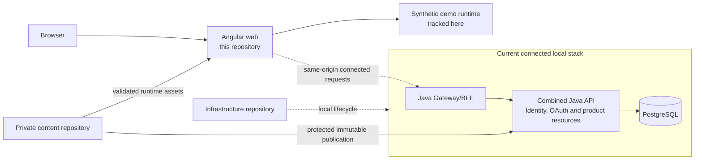
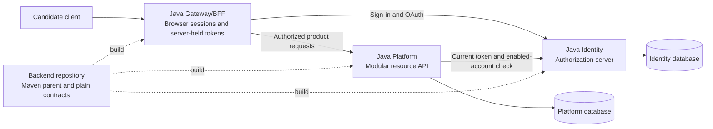
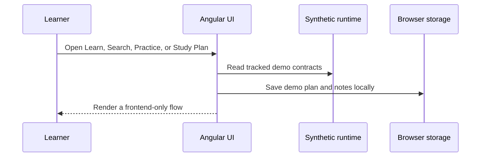

# Look Ahead Learning Web

Angular frontend for a technical learning platform organized into three connected
paths: **Learn**, **Grow**, and **Blaze**.

This is a portfolio-safe public source repository. It contains the application,
content contracts, shared learning components, tests, and deliberately synthetic
demo content. Proprietary curriculum, rankings, complete ready-made schedules,
delivery evidence, credentials, and learner data are kept outside this Git history.

## Page sidebars

The shared page shell builds an outline from visible sections and exposes already-loaded
recall/practice when available. Learn, Grow and Blaze catalogs also show the shared learning prompt in the right sidebar before a lesson is opened.
At desktop widths (1100px and above), the reader reserves 248–360px on each side, adapting to viewport width, for navigation and recall. Both panels open by default and toggle independently without covering the content.
On smaller screens, both sections start open in normal flow above the reader. Their labeled heading buttons remain visible when contents are collapsed. Sections toggle independently, and resizing preserves the learner’s choices. The homepage outline stays visible without a toggle: it occupies the left gutter on desktop and becomes a horizontally scrollable row below the header on narrow screens.
Both sidebar statements remain visible when their navigation/practice bodies are collapsed; when gutters are too small, they move into normal flow after the page instead of crowding the reader. The docked left navigation and selected row fade toward the content; the docked right sidebar is borderless and transparent. No backdrop, page lock, or focus trap is introduced. Header and breadcrumb navigation
remain available. The homepage has only a left outline and retains its signature in the
hero. Coding Problem Workspace is excluded; author pages retain their existing layout.
Section highlighting tracks the reading area below sticky lesson tools. Both docked panels use matching outer insets for equal content gaps.
Sidebar state is transient and adds no API or saved-session contract.

## Header course navigation

The Learn dropdown places Engineering Tools before Computer Fundamentals so the six-column desktop menu has a shorter second row. This presentation order does not change the catalog’s learning order.

The shared `PlatformBrand` component renders the LookAhead symbol and wordmark
in the platform header and restricted sign-in header. The title uses clean
LookAhead lettering: Look in the text color and Ahead in the theme accent.
The working header symbol uses two eyes beside a blue L-shaped wall. A thicker
right stroke of the apricot A contains a subtle I-shaped opening. Violet code
brackets frame A and distinguish code from the letter in both themes; one arrow
follows the wall's top edge, curves around it, and reaches the closing bracket. Identity tokens in `src/styles.css`
preserve these groups. The mobile header scales the icon and title;
forced-color modes retain the text name. The home link keeps its accessible
name and keyboard focus. `public/favicon.svg` uses the same standalone symbol.

The homepage closes with the Essence card, after Pricing and before the footer.
“Our platform” and the heading “The Essence of Look Ahead” stay in the page for
screen readers and the sidebar link “The essence”; visually, the wordmark is the
title and the compact symbol sits in the card's corner. The card plays in order
once most of it is on screen (three quarters of the card, or of the screen when
the card is taller). If the reader leaves before it finishes, it starts over from
the first letter when they come back:

1. `WordmarkKey` tells the wordmark's story one change at a time. It starts as
   the plain word LOOKAHEAD, with a normal L, in the text colour. Then each symbol
   appears above its letter with a soft glow in its own colour and descends onto
   it, with its own caption: the eyes onto the O's (look), the wall onto the K's
   stem (the obstacle), the code brackets onto the K and the H (code), AI onto the
   A and the H's first stroke (AI, in code), the circuit onto the E (explore and
   engineer), the algorithm frame onto the A (algorithms and architecture) and
   the door into the D (the way through). No letter dims; each keeps its colour
   until its symbol lands. Once everything is in place every meaning shows
   together, and only then does the L become the path and draw through it all to
   the door: the way through comes once you have the rest. As it draws, the
   wordmark reads as one sentence, its key words in their symbols' colours: "Look
   ahead to the obstacle, put AI to work in your code, explore and engineer with
   algorithms and architecture, and find the way through." The sentence then moves
   to the space under the steps and stays there.
2. `EssenceSteps` draws in three statements, each verb in its catalog color and
   each outcome in a contrasting identity color: Grow your engineering
   capabilities, Strengthen your competencies, Build expertise in your chosen
   specializations.
3. The staircase builds one step at a time: the step appears with its way of
   thinking (Understand the Obstacle, Find the Way, Understand the Invariant,
   Practice the Reasoning), then its circle and the line above it (Learn to Code,
   And Explore, AI Algorithms Architecture, Look Ahead), then an SVG arrow draws
   the line: up from the step before, turning right along the new step, and
   resting at its end, pointing right. On the top step it runs to the end.

Once settled, the card loops while it is on screen, starting from the summary:
every symbol stays in place, the path lifts, the plain L returns and every meaning
shows again (the statements step aside while the meanings use their strip; the
sentence is not repeated, it already stands under the steps); then the L becomes
the path and draws to the door, the stairs' arrow runs the whole staircase in two
seconds, each step's dot pulsing as it passes, and after a short rest the round
repeats. Leaving the screen puts the wordmark back together and stops the loop. Three buttons sit in the
corner: pause/play (pause freezes everything where it is, like pausing a video;
play carries on from there), skip to the end (the finished card at once) and
replay (the whole card again from the plain word). With reduced motion everything
is shown at once with the wordmark's meanings listed under it, nothing loops, and
there are no motion buttons.

Learn, Grow and Blaze open compact course directories. Course links open their
canonical route on the first click or tap; they do not expand a Course Highlights
panel or request per-course highlights. Keyboard users expand a path with Down
Arrow or Space and activate a course with Enter. Escape closes the directory and
returns focus to its path link. Modified clicks retain native link behavior.

## Platform highlights

The landing carousel uses labeled slide selectors and previous/next/play controls,
without a separate slide-name caption, reading prompt, or duplicate status paragraph.

Foundation lessons may provide an optional `beginnerGuide` (Learn) or
`teachingGuide` (Grow and Blaze) within the existing
`foundation-lesson/v1` contract. The shared reader starts with prerequisites,
a complete example, explained steps, a small exercise and takeaways. The exercise answer uses a native disclosure; the complete lesson follows
inline without an expansion step.
The guide supplies the article outline and sidebar recall. Grow uses practical
verification exercises; Blaze uses decision exercises. Scenarios render as
wrapped text, while Learn code examples remain copyable. Introductory sections share the full lesson’s typography, section surfaces, and
responsive padding, with aligned content edges. The outline includes both introductory and full-lesson sections. Detailed material and
practice stay visible in the same reading flow. Code reads top to bottom: the lead-in paragraph, the code at the content width, its run console right under it, then the paragraphs that explain the run (`codeAfterParagraph` moves the split). Long lines wrap with a hanging indent; the whole file shows, nothing scrolls inside the page. At narrow widths the reader stacks them in source order. Walkthroughs and explicit multiple points inside explanation cards use semantic bullet lists, preserving headings and single prose explanations. Unguided foundation lessons put concrete sections before
the abstract model. There is no learner execution service. Proprietary guide
content belongs in the private Content repo.

- Learn foundations, Grow production practice, and Blaze architecture,
  leadership, and engineering judgment.
- Unified Search with an optional selected-result preview, lessons, interview
  questions, hands-on practice, guided algorithm traces, and adaptive Study Plans.
- A private catalog with 730 ranked canonical DSA problems and 450 validated
  ready-made Study Plan templates. This repository includes only safe examples
  of the same versioned contracts.
- Shared Harbor Light / Midnight & Apricot Dark presentation, responsive layouts, keyboard
  navigation, and semantic interaction states.
- A frontend-only public demonstration and an optional connected local mode with
  account-owned plans, PostgreSQL, OAuth, and protected content.

## Architecture

The current connected local stack uses a separate Java/Spring Gateway process
and a combined Java/Spring API containing both authorization-server and product
responsibilities. A separate candidate splits these into three Java/Spring Boot
applications and two independently owned databases. The candidate has not
replaced the current stack or migrated its data.





The candidate Gateway has no database credentials. Identity owns credentials,
OAuth state and signing keys; Platform owns product permissions, protected
content, plans, progress and support state. Plan/version/activity/receipt writes
remain one Platform transaction. Backend supplies shared build tooling and
transport contracts; it is not another running application.

Route-level pages are lazy-loaded. Content services translate versioned JSON
contracts into view models; reusable components own recurring learning behavior.
Pages must not infer authorization or repair invalid private content.

## Repository relationships

| Local repository folder             | Source boundary                                         | Responsibility                                                                                                 |
| ----------------------------------- | ------------------------------------------------------- | -------------------------------------------------------------------------------------------------------------- |
| **`lookahead-learning-web-public`** | Public web source (`lookahead-learning-web`)            | Angular product, synthetic standalone demo, UI contracts and browser integration                               |
| **`lookahead-learning-api`**        | Public compatibility baseline (`lookahead-content-api`) | Current combined Spring API and separately launched Gateway profile, existing schemas and migrations           |
| **`lookahead-learning-gateway`**    | Private candidate                                       | Browser sessions, server-held OAuth tokens and fixed Identity/Platform routing                                 |
| **`lookahead-learning-identity`**   | Private candidate                                       | Credentials, enabled identities, OAuth clients/authorizations, signing keys and Identity database migrations   |
| **`lookahead-learning-platform`**   | Private candidate                                       | Product capabilities/grants, plans/progress, protected content, support state and Platform database migrations |
| **`lookahead-learning-backend`**    | Private shared build                                    | Maven parent, plain transport contracts, application image build and verification tooling                      |
| **`lookahead-learning-infra`**      | Private infrastructure                                  | Local lifecycle, separate database roles, Compose, environment configuration and deferred AWS definitions      |
| **`lookahead-learning-content`**    | Private content                                         | Curriculum, rankings, Study Plan templates, publication tools, private architecture previews and evidence      |

The four candidate application/build repositories are sibling checkouts with
these exact folder names. Their Maven build resolves local sibling sources;
reproducible builds need compatible revisions of all four. Candidate startup and
database provisioning belong to Infra. Existing-state migration, rollback,
production hosting and a live cutover remain separate work.

The public web and API demonstrations never require the private repository.
Private review builds copy only validated runtime assets into an ignored staging
directory; those files must never be committed here.

Node-based frontend and author/delivery handlers, the key-protected Python preview
source, SMTP capture and lifecycle/probe scripts are local development and
verification tools. They are separate from the Java/Spring product applications.
They do not define production hosting or activate learner code execution.

## Learner flows

Public demo:



Current connected OAuth mode:

```mermaid
sequenceDiagram
  participant L as Learner
  participant W as Angular UI
  participant G as Gateway/BFF
  participant A as Combined API and authorization server
  participant P as PostgreSQL
  L->>W: Sign in or open protected content
  W->>G: Same-origin authentication request
  G->>A: OAuth/API exchange
  W->>G: Same-origin account or protected-content request
  G->>A: Server-held access token
  A->>P: Read or write account-owned state
  A-->>G: Authorized response with revision metadata
  G-->>W: Browser response; tokens remain server-side
  W-->>L: Refresh plan, progress, or content state
```

## Run locally: public demo

Requirements: Node.js 24 and the exact npm version declared in `packageManager`
(currently npm 11.17.0). The Angular packages use the patched 22.2 family;
the lockfile resolves Angular 22.2.1 and Piscina 5.3.2. After dependency updates,
run `npm ci`, `npm run security:dependencies`, and `npm run test:security-gates`
before frontend tests and builds.

`npm run test:coverage` instruments all production TypeScript under `src`, including files never imported by tests, using the matching pinned Vitest V8 provider. Only test files, declarations and test setup are excluded. CI requires at least **85% line coverage**; branch coverage is reported separately. Standard LCOV, JSON and HTML reports are in `coverage/lookahead-learning-web/`. The app-owned CI check enforces the threshold without a private checkout. Infra separately validates complete current reports for Web, Gateway, Identity and Domain before DEV and PROD deployment; missing, failed, stale or below-threshold results block both. These checks do not publish reports or private fixtures to the frontend.

The exhaustive Hands-On DSA route test visits all 32 pages plus the Previous link and uses a test-specific 30-second timeout for instrumented parallel CI. All pagination/deduplication assertions remain active; other tests retain their default timeout. A targeted route-file run is useful for diagnosis, but only the full application run can satisfy the 85% coverage gate.


Unit tests isolate each file so component overrides and browser mocks cannot leak
into another suite. `npm run test:order` runs the same assertions in a shuffled
order with one worker (seed 1106), to check fixture and mock cleanup within files.

Authored HTML used in plain-text lesson labels, pattern names and problem prompts
passes through `src/app/core/html-text.ts`. It parses a detached document, removes
script/style/template content and decodes entities once. Its output belongs only
in text bindings; it is not an HTML sanitizer. Run its regression tests together
with the affected lesson, pattern and question component tests after changes.

```shell
npm ci
npm start
```

Open http://localhost:4300. This mode always uses `demo-content/runtime`, even
when a private sibling checkout exists. It needs no API, database, Docker,
credentials, or private content. Plans and notes stay in this browser.

Useful routes:

| Route                              | Experience                                                               |
| ---------------------------------- | ------------------------------------------------------------------------ |
| `/`                                | Landing and platform overview                                            |
| `/learn`                           | Foundation catalog                                                       |
| `/grow`                            | Production-practice catalog                                              |
| `/blaze`                           | Architecture and leadership catalog (Blaze)                              |
| `/search`                          | Unified topic and learning-mode discovery with optional result summaries |
| `/learn/hands-on-dsa`              | Ranked DSA practice catalog                                              |
| `/study-plan`                      | Study Plan creation, review and progress                                 |
| `/sign-in`, `/sign-up`, `/account` | Account entry and profile surfaces                                       |
| `/support`                         | Support and feedback surface                                             |
| `/pricing`                         | Sample plans and prices (DLV-209); design only, checkout not connected   |

The three Learn, Grow, and Blaze cards on `/` are full-area native links to
their catalog routes, including keyboard focus and normal browser new-tab actions.

`/pricing` is a design sample of the agreed plan catalog (DLV-209). The catalog has
one source, `src/app/content/membership-plans.ts`, which Pricing, the `/account`
Membership section and the owner's People and access page all read. It holds yearly
plans (Learn, Grow, Advance, Complete), passes (Interview Sprint, Course Pass), promo
plans (Monthly, Annual and Interview Pass Promo) and the change rules.

- Nothing renews automatically; every paid row shows "Manual renewal".
- Offers with undecided terms (Course Pass length, promo eligibility and sale end dates)
  show "Not on sale yet" and have no Choose button.
- Every other Choose button opens a native dialog saying checkout isn't available and
  nothing is charged. The page makes no requests, posts no form, loads no payment
  script and stores no choice.
- Everyone can see prices; buying needs an account (user, 2026-10-15). A signed-out visitor's
  **Choose …** opens "Sign in to buy a plan" (Sign in / Create account, returning to
  `/pricing`).
- Ways in:
  - the plans section on the home page, just before the Essence (`/#pricing`, which the home
    page scrolls to on arrival); during a sale its first card is the sale;
  - `/start-free` → **What you're missing** (paid units of the same courses, with the plans
    that include them);
  - the lock screen and dialog (**See pricing** → `/#pricing` when signed out; **See plans** →
    `/pricing` with "Included in …" when signed in);
  - **Choose a plan** in `/account` → Membership.
  - The header has no pricing link (user, 2026-10-15). The three mockups stay on
    `/preview/header-plans` for reference.
- **Sales** (`src/app/content/sale-preview.ts`): promo plans appear only while a sale runs. They
  show above the regular plans, which stay read-only, with the regular price for comparison.
  - No server support exists, so learners never see a sale.
  - Authors and admins start a sale preview and preview prices on `/admin/sales`. It is stored
    in their browser only, and `/pricing` gives them a Regular / Sale preview switch.
- **Unit-card labels follow the viewer:** signed out sees Open / Sign in to read / Paid plan;
  signed in sees "Paid plan" only on courses they cannot open.
- `/account` separates a free account, individual course access and a paid membership.
- Its purchase list (`account-access-records`) renders only from purchase records, which
  the server does not provide yet. The proposed API is in the content repository's DLV-209
  evidence.
- Access is still decided by the server's course grants.

The Blaze catalog (formerly Look Ahead, renamed in DLV-931) lives at `/blaze` with the
data id `blaze`: `/content/blaze/...` assets, topic ids such as `blaze:system-design`, and
`--path-blaze` tokens. The platform keeps the name Look Ahead, so browser storage keys keep
their `look-ahead.` / `look-ahead-` prefix. `CatalogUrlSerializer` (`src/app/core/catalog-url.ts`)
opens old `/look-ahead/...` links on the matching `/blaze/...` page, and
`upgradeLegacyCatalogJson` upgrades study plans saved in the browser before the rename.

The approved DLV-801 Search refinement uses compact, full-title result rows.
Results occupy the full desktop width until a row is selected through its native
button. Selection opens a companion beside the list and presents that result in
a separate sticky slot above the remaining rows. A visible Close preview control
returns to the full-width list. Sticky positions follow the measured Search
controls, keeping the companion title and action visible during desktop scroll.
The remaining rows retain their rank and group order, and closing the preview
restores the original list. At
800 CSS pixels and below, one preview opens directly beneath its row without
moving the row. Short desktop viewports use normal flow instead of sticky pinning.
Path, course and difficulty links remain separate controls. Hover, keyboard
focus and persistent selection have distinct visible states; the page uses
normal document scrolling without a mobile dialog or duplicate answer tree.
Result rows omit a synopsis when it only repeats the displayed title.

The selected result is shareable as `previewItem` in the Search URL. Selection
replaces the current history entry; reload and Back/Forward navigation restore
valid URL context without a new history entry per click. A new query clears the
selection, while sorting, grouping and loading more preserve it when valid.
Filters clear an excluded selection. The Filters popover closes on an outside
click or Escape; Escape returns focus to its summary. The preview shows a full
title, an existing indexed summary where
available, one canonical full-content action and a Details disclosure with
course, module, difficulty, available languages and actionable subject filters.
Missing preview content is described honestly. Empty Languages metadata is
omitted; `language=unspecified` remains a usable Search filter. Premium is
passive metadata, not an access grant. Explain-format interview questions load
only the canonical short `interviewAnswer` through the existing access-checked
route; **Read full answer** opens the complete question. Previewing makes no
account, Study Plan or progress write.

The approved heading, exact result counts, learning modes, filters, query
precedence and canonical routes remain in place. The local integrated preview
is development behavior and does not claim production deployment or a new API
contract.

Choose another free port when needed:

```shell
npm start -- --host 127.0.0.1 --port 4317
```

## Run locally: private browser-only review

Keep `lookahead-learning-content` beside this repository, then run:

```shell
npm run start:private -- --configuration demo --host 127.0.0.1 --port 4318
```

The application copies private `runtime/` content into ignored local staging.
It still uses browser-local plan state and makes no account persistence claim.

## Run locally: connected platform

Use the sibling infrastructure repository to start the named PostgreSQL, API,
mail, and OAuth gateway services. Then run:

```shell
npm ci
npm run start:connected -- --host 127.0.0.1 --port 4316
```

Open http://127.0.0.1:4316. Checked-in proxy contracts send `/bff/**`, `/content/**`
and OAuth client callback routes through gateway4330. `/api/**` and
authorization-server routes target the combined API on4320. The connected OAuth
account flow uses the BFF so access tokens stay server-side. Private
content appears only after an authorized immutable publication has been prepared
and mounted by the local infrastructure workflow.

See `lookahead-learning-infra/docs/local-accounts.md` and
`lookahead-learning-infra/docs/oauth-local.md` for service startup and shutdown.
Do not start a second stack for a frontend-only styling change.

### Custom Study Plan builder

Open `/study-plan?create=1` to build a custom plan through five progressive
steps: setup, Learn, Grow, Blaze, and review. Setup must be valid before the
course steps open; each path may be left empty as long as at least one accessible
course is selected across the whole plan. The current step is URL-owned for
Back/Forward navigation, while unsaved choices use session-scoped draft intent so
a reload or sign-in continuation does not create a saved plan. The final Review
step summarizes the setup and all three paths before generating the existing
temporary schedule. Save remains an explicit action inside that schedule review.

Course choices use a three-column desktop grid, two columns on tablet and one on
narrow mobile. Ready-made plans keep their separate picker and adoption guard;
the custom builder does not impose ready-made foundation policy on learner-selected
plans.

Signed-in free accounts see one Free starter plan and can inspect read-only
samples of authored plans. The free schedule is fixed to seven days and one hour
per day; other duration and hour choices remain visible but locked. Free starter
and custom free-content drafts offer an explicit account save. Paid-plan samples
remain preview-only. The matching Domain implementation enforces two active
free-content plans, three successful deletions per rolling 21 days, and 15
lifetime free-plan creations including imports. The working Local stack behind
4301 runs this implementation as of 2026-10-16. The dashboard separates archived plans and
confirms deletion. The proposed 30-day archive after paid access loss remains
open DLV-938 work.

### Active Study Plan

Open `/study-plan?plan=<id>` to continue a saved account plan. The page uses
**Study Plan** as its learner-facing title, presents the saved goal as the tagline,
and keeps duration, recovery, saved state and plan actions together near the page
heading. The same active-plan card continues into the always-visible
**Protect the time you have.** first-week allocation above the activity desk.
Beside the time summary, a compact 2×2 editorial grid presents four page-description
statements: browsing follows saved progress without moving it, completion records
practice rather than mastery, progress belongs to this plan, and Learn/Practice/Recall
fit within the learner's chosen time. Account mode identifies the saved account;
browser-local mode identifies the current browser honestly.
**Topics in your plan** and its stateful Hide/Show control
share the left rail. Browse a topic,
activity, or recall without changing progress. The former standalone next-activity
and Resume strip is removed; the underlying eligible daily queue and recorded
study-day selection remain the source of recommendations. No separate reading
bookmark is persisted. Returning from a contextual reader restores the viewed
activity independently of that recommendation.

The selected study day renders its actual scheduled activities as responsive
cards. Each card carries the canonical Open action, its explicit progress control,
and the item's complete scheduled strategy sequence. Understand, Practice and
Recall occurrences are clickable compact controls that move to the occurrence's
real study day without recording progress.

The former **Plan overview and time allocation** and **Daily schedule and
adjustments** disclosure sections are removed from the active view. Their useful
entry points remain in the heading-level plan actions and the visible allocation
summary, avoiding a second copy of the day activities below the card grid.

Progress changes only through explicit completion, attempt, review-note, or
recovery controls. Every available activity has a content-aware link to its
canonical lesson, question, or problem; opening content never records completion.
Completion can be undone where the existing activity contract supports it. The
complete schedule, daily adjustments, revision history, source pins and access
checks remain available. No learner-code execution is enabled.
Connected mode uses the existing account activity API; the standalone demo saves
only in the current browser and does not synchronize across devices.

### Manage account

The signed-in account page has a full-height rail at the window's left edge with
the learner's initials, name and sign-in email and an **Account sections** menu:
Study plans, Profile, Appearance, Security and Active sign-ins. The content fills
the space beside the rail (up to 1600px). A hero holds the page heading, a
greeting, the Continue learning, Study Plan and Search actions, the account's
**Membership** and the saved-plan count (once the plan list is confirmed). From
1360px the sections form two columns: Study plans, Profile and Active sign-ins
span the width, and Appearance sits beside Security. The menu marks the section in view and, below
900px, becomes a wrapping row above a single column. On this page the header
leaves out Search, Study Plan and the theme switch, and the platform statements
and lesson sidebars are not shown.

**Appearance** offers Light, Dark and System (System follows the device's setting
as it changes). Signed in, the choice is saved to the account through
`POST /api/v1/account/preferences` and applied after every sign-in, on any
browser; the header's Light/Dark switch saves the same way. Signed out, the theme
is a browser preference only. **Profile** shows the name (with a pencil button that edits it in place) and the
sign-in email (not changeable yet) beside a
**Membership** block derived only from server grants: Author (author access),
Course access (granted course count and paths) or Free. Paid plans (DLV-209) are
not active, so no product name or upgrade action is shown; the block notes that
access is checked when a lesson opens and offers **Browse your courses** buttons
for the covered paths (Learn, Grow, Blaze). Below, **Profiles and links** shows Google, then GitHub,
LinkedIn, X and Portfolio, as their official logos (names kept for assistive
technology), each with an Add or Edit button that opens one form
(`POST /api/v1/account/links`, https addresses only). Saved links open in a new tab
and say so. Google shows its real status and a disabled Connect button.

Open **Manage account** from the signed-in account menu to review your profile,
edit your display name, or change your password. Password changes require your
current password and sign you out of every supported session after confirmation.
The signed-in account view uses a full page layout with responsive account sections;
the sign-in and sign-up forms remain compact. Authentication pages omit the
redundant header Sign in link while session restoration is in progress.

The **Study plans** section lists the account's saved study plans using
the already-loaded account API data. Each plan links to `/study-plan?plan=<id>`.
Session progress is displayed only when the API supplies available, valid counts;
missing metadata is not treated as zero progress. Duration, daily time and the
last-updated date are shown when supplied; a thin progress bar beside the
session count is decorative and hidden from assistive technology. Loading and failed requests remain
distinct from an account with no saved plans. The section's **Create study plan**
button opens `/study-plan?create=1`; with no saved plans, the empty state offers
**Create a study plan** instead. The current plan-card contract has
no lifecycle status, so this view does not infer an active plan from dates.

**Continue learning**, **Study Plan**, and **Search** are native navigation links
styled as actions. Continue learning preserves its validated return route,
including query parameters and fragments; identical destinations are not repeated
within the action group. Viewing this page does not create, select, or modify a plan.
These account features require connected mode; the standalone public demo retains
its browser-local behavior.

### Active sign-ins (connected Identity contract)

Manage account includes an authoritative inventory of active logical sign-ins.
Local development has no admission cap; DEV and PROD permit at most two. Tabs
sharing one browser session count once; another browser profile or private session
generally counts separately. Browser/device descriptions are
approximate. The current sign-in can have an optional label. Individual Sign out
and Sign out other sign-ins require explicit confirmation and preserve saved work.
Changing a password retains the stronger behavior of ending every sign-in.

Refresh list restores focus to its control after loading or failure and announces
the result. The Local count uses singular or plural text, and current-session
confirmation describes the actual number of other active sign-ins.

This slice requires the DLV-920 Identity/Gateway contract. It uses the same-origin
Identity routes under `/api/v1/account/sign-ins` and does not derive authorization
from client labels or identifiers. A recent-authentication rejection preserves the
current account and draft. Confirming the current password uses the existing login
flow; the learner must then explicitly resubmit the requested change.

A third successful password proof in DEV or PROD returns `SIGN_IN_LIMIT`. The frontend opens the
restricted `/sign-in/choose` page, which has no learner navigation or account-data
initialization. The learner selects a sign-in to end or cancels. Only acknowledged
replacement proceeds through the normal OAuth/BFF continuation. Cancel returns to
sign-in while keeping existing sign-ins, and validated return URLs reject external
or sign-in-loop destinations. Expired challenges require a fresh sign-in. A failed
or lost response is not presented as successful admission or revocation.

Frontend tests exercise these contract responses with synthetic data. A disposable
Local integration check also verified third-sign-in cancellation/replacement,
current and other-session revocation, label updates and unrelated-account
continuity through the browser and independent HTTP clients. Admission concurrency,
token/code revocation and service recovery remain service-owned protocol gates.
This is Local development verification, not production or native-zoom certification.

### Isolated local delivery editor

Use `start:private` when the author Delivery Plan needs its local editor. Plain
`ng serve` does not provide `/__local/delivery` and can show Plan unavailable.
`LOOKAHEAD_BASE_PROXY_CONFIG` selects a JSON base proxy before the startup script
adds its token-protected local editor route. Targets must be HTTP loopback
services; the selected file cannot override `/__local` or dynamic proxy routing.
Omitting the variable preserves the checked-in `proxy.conf.json` defaults.

For the protected working UI on4301 connected to Gateway4350:

```sh
LOOKAHEAD_CONTENT_ROOT=/absolute/path/to/private-content/runtime \
LOOKAHEAD_BASE_PROXY_CONFIG=/absolute/path/to/infra/environments/local/proxy.development.json \
npm run start:private -- --configuration protected --host 127.0.0.1 --port 4301
```

The content root stays outside the public repository. Generated content and proxy
files are ignored; the proxy carrying the local editor token is owner-readable
only and removed on shutdown. On protected4301, each editor request also checks
the current server-held author capability through Gateway4350; the local token
alone does not grant browser access. Keep other running UI instances on their own ports.
Delivery Plan is guarded by the server-provided author capability, including its
legacy `/delivery` redirect, and is absent from the public landing footer.

### Local author previews

For an account with the server-provided `authorPreview` capability, the **Admin**
portion of the account menu lists, in this order, **Documentation** (`/admin/docs`),
**Previews** (`/admin/previews`), **Delivery Plan** and **People and access**
(`/admin/access`). Each link appears only when the server-provided permissions allow it
(`previewDocuments`, `deliveryRead`, `manageAccess`; co-authors and feedback triagers
also see People and access). Platform reviews are a
tab of **Support and feedback** (`/support?view=reviews`); see below. The Documentation home lists twelve protected pages in three
reader groups: Start here (Reviewer guide, Pages & screen names, Content access
checks, Plans and purchases with its Sales and prices sub-page), How it works (Architecture, Sign-in & authentication, API reference) and
Run and release (Local setup & development, Release gates, AWS deployment,
Operations, Production support). Each documentation page lists the same groups in the
right-hand admin menu, below the Admin links; other admin pages show the Admin
links only. Every admin destination retains its author guard.

DLV-926 moved these pages from `/author/...` to `/admin/...` on 2026-10-11 and
removed the former `/author` landing page. Old `/author` addresses redirect to
their `/admin` pages. The Gateway's sign-in return allowlist still accepts only
`/author`, so the web app sends `/admin` destinations to the Gateway as the
matching `/author` address and the redirect brings the person back; adding
`admin` to that allowlist is a pending Gateway change.

The protected environment sets `authorPreviewsBaseUrl` to `/bff/author/previews/`;
the default, demo, and public production environments leave it empty. An empty
configuration shows an unavailable state and makes no inventory request.
Use the connected stack's existing `/bff/**` proxy to its OAuth gateway. The
working development stack uses gateway4331; select its matching proxy JSON when
starting the UI. Do not add a direct static-server proxy or start the preview
service from the UI.

The page reads `preview-directory/manifest.json` under the configured mount. It
expects `schemaVersion: "author-previews/v1"`, `urlBase: "manifest-directory"`,
and entries with `id`, `group`, `title`, `status`, `note`, `available`,
and `links` (`label`, `href`, optional `theme`). Relative links resolve against
the manifest URL. A single-leading-slash link refers to the private tree root
and is rebased under the configured mount; already-prefixed links are preserved.
Every resolved link must stay inside that mount. Preserve the whole
preview tree so sibling assets and query strings continue to work. Private HTML,
the inventory, and curriculum are never copied into the public application.

The gateway contract checks the authenticated server author capability and current
trusted catalog grants for each manifest and asset request. It returns 401 when
signed out and 403 for a learner. The Angular guard controls page navigation;
the gateway owns authorization for the actual files. Public production builds
leave this configuration empty. Service failures and incompatible inventories
show an explicit retry state. The Documentation Architecture link opens the canonical
document directly; its existing tabs provide the data model and end-to-end views.
The private Architecture source also includes a Local development workflow tab;
the Author page outline keeps the protected route and selects that tab when its
section is chosen.

The collections contract supplies explicit `order`, `featuredEntryId` and
`historyEntryIds`. The page displays one featured card per collection, in curated
review order, and compact collapsed links for earlier versions and alternatives.
Featuring a preview does not imply selection or approval. Search also matches
history entries and expands matching collections so those links can be found.

Version-bound Study Plan reviews embed the protected learner-style schedule as
their primary preview. The canonical packet, decisions, and technical evidence
remain secondary actions. Review controls stay in trusted Angular outside the
sandboxed iframe; opening a preview never records a plan or review decision.

## Main source areas

```text
src/app/
├── content/     versioned contracts, adapters, Search and Study Plan logic
├── core/        shared header, reader, debugger, practice and tutor components
└── pages/       lazy route-level product surfaces

demo-content/runtime/   tracked redistributable demonstration data
scripts/                publication, validation, profiling and local-start tools
docs/                   public architecture and source-boundary documentation
```

Shared interaction colors use Harbor teal in Light and Apricot in Midnight Dark
for primary actions, with blue links in both modes. See [platform theme](docs/theme.md)
for shared tokens, semantic exceptions and verification. Learn, Grow, and Blaze identity colors are small
labels or structural markers; they do not recolor generic actions.

Destination cards expose their primary action over the entire card while keeping
secondary links and controls independent. See [whole-card navigation](docs/card-navigation.md)
for implementation and keyboard/pointer verification.

The platform header is sticky at its component boundary so the logo, navigation,
Search, Study Plan, theme and account controls remain at the top while reading.
Author documentation's **On this page** outline highlights the current section
as the document scrolls, separately from the current Author workspace page.
Tracking does not rewrite the URL or move keyboard focus. Embedded references
report visible heading offsets through a bounded, source-checked message exchange.

## Search engines and link previews (DLV-941, phase 1)

**Titles and meta tags.** `src/index.html` ships the home title
`LookAhead | Learn. Grow. Blaze.` and a default description, so a client that
does not run JavaScript still sees both. After every navigation,
`PageTitleStrategy` (`src/app/core/page-meta/`, registered in `app.config.ts`)
sets the page's `<title>`, meta description, canonical link, Open Graph
(`og:title`, `og:description`, `og:type`, `og:url`, `og:image`, `og:site_name`)
and Twitter card tags through `PageMetaService`:

- Static pages are described in `page-meta-routes.ts`, keyed by the route's
  configured path; `app.routes.ts` needs no meta data. A route `title` overrides
  the table. The home page keeps its title.
- Course, module, section and lesson pages first show their catalog's meta, then
  their own once `PublicPageMetadata` has loaded the course's public
  `content-locator.json` (one request per course per session). Titles read
  `Lesson | Course | LookAhead` and `Course | Learn | LookAhead`.
- Account, sign-in, sign-up, support, study plan, delivery plan, admin, landing
  previews, Search and unknown addresses get `robots: noindex`.
- Public pages outside the catalogs carry a one-line flag in
  `src/app/core/page-meta/indexable-pages.json`, read by both the meta tags and
  the sitemap: `start-free` is `true` (indexed, listed); `pricing` is `false`
  (noindex, not listed) while its prices are a sample. Flip the flag to change it.
- Canonical and `og:url` are the current origin plus the path, without query or
  fragment. `og:image` is a shipped card scene: the landing scene for a catalog,
  the course scene for a course, and an authored `/assets/scenes/` unit scene
  for module and lesson pages (otherwise the course scene).

**Privacy boundary.** Meta text uses only metadata that signed-out visitors
already receive: catalog/course/module/section/unit titles and descriptions and
lesson titles from the public-tier course locator. `PublicPageMetadata` requests
nothing else (no lesson detail, answer slides or other grant-protected file) and
copies only allowlisted title/description fields, so a protected lesson body,
answer, summary or code cannot reach a meta tag. `page-meta.spec.ts` and
`page-title-strategy.spec.ts` enforce this.

**robots.txt and sitemap.xml.** `scripts/build.mjs` runs
`scripts/generate-seo-files.mjs` (also `npm run seo:files`) before `ng build`,
writing the Git-ignored `public/robots.txt` and `public/sitemap.xml` that Angular
copies to the site root:

- `robots.txt` allows everything public and disallows `/admin`, `/author`,
  `/account`, `/delivery-plan`, `/delivery`, `/sign-in*`, `/sign-up`, `/support`,
  `/study-plan` and `/preview/`. `/content/` stays crawlable because pages render
  from it.
- `sitemap.xml` needs absolute URLs, so it is written only when
  `LOOKAHEAD_SITE_ORIGIN` is set to the production origin (for example
  `LOOKAHEAD_SITE_ORIGIN=https://www.example.com npm run build:protected`). The
  origin is not decided yet; when the variable is unset, the build writes no
  sitemap, removes an old one, and `robots.txt` has no `Sitemap:` line. A value
  with a path, query or credentials fails the build.
- It lists home, the Learn/Grow/Blaze catalogs, pages flagged `true` in
  `indexable-pages.json`, every available catalog course
  that is not hidden, and the lesson routes of units listed in `publicUnits` of
  the content's `policies/content-samples.json` (looked up inside or next to the
  content root), minus retired lessons. Registered-free units need an account and
  are not listed. Without that policy file, only catalog and course pages are
  listed.
- Content source: a protected build reads `LOOKAHEAD_CONTENT_ROOT`, other builds
  the runtime copy `content:sync` prepared in `public/content` (then
  `LOOKAHEAD_CONTENT_ROOT`, then the demo). `npm run test:seo-files` covers the
  generator.
- `ng serve` serves the files only after a build or `npm run seo:files` has
  written them.

**Phase 2: per-page HTML files (lighter option, 2026-10-15).** After a successful
`ng build`, `scripts/build.mjs` runs `scripts/generate-route-snapshots.mjs`, which writes
`<route>/index.html` into the build output for every sitemap page except home.

- **What a page file holds:** the built shell with that page's title, description,
  `og:*` and `twitter:*` tags, plus a short plain-text summary (heading, description and
  links) inside `<app-root>`. Angular replaces the summary when the app starts.
- **Serving:** nginx already serves these files (`try_files $uri $uri/ /index.html`).
  The root `index.html` stays the generic shell, because it is also the fallback for
  account, admin and unknown addresses.
- **Where the text comes from:** public metadata only. `src/app/core/page-meta/public-page-text.json`
  is shared with the app's title strategy, and the rest is `catalog.json`, `course.json`
  unit titles and descriptions, and the titles of lessons in public units. No lesson body,
  answer, summary or code goes into a page file.
- **Origin:** canonical, `og:url` and `og:image` are written only with
  `LOOKAHEAD_SITE_ORIGIN`.
- **Not covered:** full lesson text (that would need Angular SSR/prerender), raster preview
  images, and a link-preview validator check. Card scenes are SVG, which several unfurlers
  (Facebook, LinkedIn, X) do not accept for `og:image`.
- `ng serve` does not use these files; check them in `dist/` after a build.
- `npm run test:seo-files` covers both generators. The deployed origin and hosting are
  DLV-913 and DLV-914.

## Verification

For a frontend-only change, run affected unit/component checks, a build, and a
targeted browser check. A changed auth, API, persistence, sync, or recovery
boundary also needs the relevant API and cross-service checks.

Complete public verification:

```shell
npm run validate:source-boundary
npm run validate:public-readiness
npm run validate:content
npm run validate:content:ci
npm test -- --watch=false
npm run build
```

Private content verification uses `npm run validate:content:private` and
`npm run build:private` with an authorized sibling content checkout.

See [Architecture](docs/architecture.md),
[Content Boundary](docs/content-boundary.md), and the
[Public Repository Runbook](docs/public-repository-runbook.md).

## Current limits

- The public fixture is intentionally small and does not represent the private
  curriculum.
- Browser-only plans do not synchronize across devices.
- Hands-On DSA practice progress is saved in the current browser only, in every
  mode (including connected local mode); it does not reach an account or another device.
- Connected OAuth/PostgreSQL is local development, not production certification.
- Learner code execution is deferred; dormant candidate code is not a learner
  capability.
- AWS deployment, billing, and live AI-provider integration remain separate work.

## Repository status

No open-source license has been selected. Public visibility does not grant reuse
or redistribution rights.

## Private author review

Previews opens with links to the live product and the author-owned Study Plan sample views, followed by the design inventory labelled **Design history** with its build date. It includes a versioned Study Plan review entry and the `/admin/previews/study-plan` route. Private scope, version, evidence and decisions come from the capability-protected author-documents publication, not the public bundle. The embedded HTML uses a scripts-only sandbox; review controls belong to Angular outside the document.

The review adapter uses the BFF-protected Domain artifact registry and account-scoped review-event history. Decisions bind the canonical artifact ID, artifact version, owning ticket and source hash; the rendered HTML hash is separate display provenance. Writes use BFF CSRF and a header-only idempotency key. Decline and Need more require an explanation; comments are limited to 2,000 Unicode codepoints. Replacing a prior decision is explicit and supersedes the latest event for that account. A conflicting change requires reloading history and reviewing the new replacement target.

Uncertain submissions preserve the draft and exact retry key. A later page load reads authoritative history instead of inventing a local result. A recorded decision remains pending Main reconciliation, not ticket completion or authorization for Git changes or deployment. A disposable Local author fixture verified recording, refresh and Domain restart persistence, and a real two-tab supersession conflict. These checks supplement unit/component tests; they do not establish production durability. If publication, artifact binding or history cannot be confirmed, recording stays disabled.

## Support and feedback, and Platform reviews

`/support` has a **Contact support** form for every signed-in account: a request
type (problem, feedback or question), reply email, subject, message and up to three
screenshots, sent once with an idempotency key and confirmed with a reference.
When the review service recognises the account as a reviewer or the owner, the page
adds a **Platform reviews** tab (`/support?view=reviews`). The former
`/admin/reviews` address opens that tab.

Platform reviews collect pre-release feedback. A reviewer adds any number of items
(type, page, importance, title, description and up to six PNG, JPEG or WebP images,
5 MB each and 20 MB per item; pasted screenshots are accepted) and sees only their
own items. The owner has two views: **All reviews** shows every reviewer's items,
per-reviewer counts, filters and a status and note that the reviewer then sees;
**My reviews** is exactly the reviewer view, where the owner adds their own items.
Anyone can edit or delete their own item until the owner changes its status.

Items are grouped by the day they were sent, newest day first (about 30 days per
page, then **Show older days**). Each row shows the title, reviewer, type, page,
importance, time, image count and status; opening it loads the description, the
owner's note and the images, one item at a time.

The tab talks to a `PlatformReviewClient`; the `/support` route provides
`ConnectedPlatformReviewClient` (DLV-928), which calls `/bff/api/v1/platform-reviews`
with the BFF session, CSRF and an `Idempotency-Key` that is reused when the same form
is retried. Images are fetched with the session and shown as `blob:` URLs. The server
decides owner, reviewer or no access; an account without a role sees only Contact
support. Invited reviewers do not need admin access. The page needs the Gateway and Domain API;
the public demo has no review service.

## Private Operations reference

The admin documentation routes (`/admin/review-guide`, `/admin/screen-names`, `/admin/access-checks`, `/admin/authentication`, `/admin/local-development`, `/admin/operations`, `/admin/aws-deployment`, `/admin/release-gates` and `/admin/production-support`) read protected, immutable author-documents through the Gateway with one shared page component. Operations covers Local environments, deployment order, rollback and repositories; the cloud candidate, release gates, authentication walkthrough and production support runbooks each have their own page. Neither executes commands or reports live service health. The public demo has no publication configured. The source documents remain outside this repository.

Previews, Documentation, Delivery Plan and every documentation page use three columns,
including while the Delivery Plan is loading or unavailable. The left sidebar holds the
page title and “On this page”, the headings in the current view. The right sidebar is the
Admin menu (Documentation, Previews, Delivery Plan, People and access, each shown only when
permitted); on a documentation page it also lists the twelve reference pages in their three
reader groups. The Delivery Plan hero sits in the
centre column so both sidebars start beside it. Narrow viewports stack the Admin menu,
then the outline, above the content. The desktop sidebars stay beside the article as the
page scrolls. It scrolls independently only when its links are
taller than the available viewport; narrow viewports stack it in the page flow with a bounded height.
Document outline links retain the protected Author URL and scroll the parent
page to the chosen embedded section; the raw reference remains available only
through its explicit full-page link.
Operations shows the published reference version above the document. Its
Repository and runbook links and Supporting references are regular sections in
the main reading flow with matching links in the heading outline.
Each documentation page (including API reference and Architecture) opens with a hero in its
reader group's colour (`AuthorDocHero`) and ends with the published version and the
full-reference link. Links the guide mentions are listed under **Links in this guide** (on
Operations, **Source repositories and runbooks**).
Every code block in a documentation page or the API reference has a **Copy** button. The
document's scripts-only sandbox has no clipboard access, so it posts
`lookahead:author-document:copy` to the admin page, which validates the sender and copies on the
reader's click (`AuthorWorkspaceNav`). Local setup & development also shows a collapsed
**One-command setup** card with a **Download** button for `lookahead_setup.py`, a
hash-addressed file in the protected author-documents publication (`downloads` in its
manifest entry); the sandboxed document cannot offer downloads itself. On narrow screens the right-hand Admin menu starts
collapsed so the page content comes first.
The shared Operations, Local setup, API and Architecture documents report their content heights to the
parent, so their references flow with the page rather than inside a fixed-height
viewer. The Author pages use a continuous three-column reading layout; the
document frame keeps its script-only sandbox without adding a second visual page.
The working `/delivery-plan` requires an active author session. Signed-out
visitors go to sign-in and return to the plan afterward; its public JSON fallback
is intentionally unavailable on the protected working origin.

The manifest uses `schemaVersion: 1` with `documents[]`. HTML URLs must match the published document ID and content SHA-256 under `/bff/author/previews/preview-directory/author-documents/`. The iframe allows scripts for theme selection and the shared Operations height report; the parent accepts that report only from its active sandboxed frame with the expected document ID and bounded size. External references are ordinary labeled new-tab links in the Angular parent. HTTP authentication, authorization, missing publication and service failures remain distinct.

## Homepage interaction

See [homepage behavior and local verification](docs/homepage.md) for the root
route, carousel, optional public challenge, shared themes and review steps.

The learner and author sidebars share `sidebar-outline.css` for navigation row spacing, selection borders, colors and text weight. This styling does not change article width.

Sign-in, sign-up, Manage Account and sign-in selection screens exclude both shared sidebars and toggles. Their form/content layout is unchanged.

Catalog sidebars on Learn, Grow and Blaze expose independently expandable course groups from AdaptiveCatalog through PageSidebarContext. They reuse loaded course data and existing routes; no additional requests or persisted state.

All three catalogs use AdaptiveCatalog’s `harbor-catalog` shell: solid surface cards, equal grid columns, shared spacing and “Inside this course” topic lists. Shared rules live in `src/styles.css` and `src/app/pages/catalog-experience.css`; section anchors leave clearance below the sticky header and breadcrumb. Course and lesson refinements remain separately scoped.

Desktop catalog and lesson sidebars stop at the outer main container; its padding remains part of the content surface.

For full-viewport reader shells, sidebar bounds use the centered article gutter with 24px clearance; bounded outer containers retain their own boundary. Main content dimensions remain unchanged.

Catalog group highlighting follows its explicit heading identity independently of expansion. Desktop reader sidebars use docked presentation only with sufficient gutter space; hover underlines are distinct from the filled active-section state.

Search excludes shared sidebars and their toggles, alongside account screens and coding workspaces.

Course overviews across Learn, Grow and Blaze use the shared course layout without global sidebars or a separate Learn-only contents map. Catalog expandable navigation and lesson sidebars remain separate.

The two platform statements remain visible independently of sidebar navigation, including account, Search and course overview pages. Coding Problem Workspace excludes both statements; homepage uses its existing in-content statements.

PageSidebarContext supports navigation-only exclusion while retaining platform statements. The Mediator Pattern question uses this mode.

Sidebar links and group controls use a tinted hover/focus background with the shared
link color and matching underline. Selected sections retain their accent border.

Standalone platform statements use the centered reader or loading/error message
gutters. When side space is insufficient, they flow below the content with normal
word wrapping instead of becoming narrow fixed columns.

Catalog sidebar subsection/course links use a dedicated teal (light) / mint (dark) token; parent
section controls retain bold neutral text. Indentation and hover/focus cues remain.

Catalog sidebar section controls expand their course links on first activation.
Activating an expanded control collapses its courses and navigates to the matching
page heading, updating the fragment and focus with the shared header offset.
Learn shows Foundation Tracks once beneath its sidebar title; the repeated
Foundation track labels are omitted from the page sections.

Catalog sidebars highlight the path title and track label while the overview is
current. Scrolling into a group transfers the single current-location highlight
to that group; scrolling back restores the overview highlight. Learn uses
Foundation Tracks, Grow Production Capabilities, and Blaze Senior-readiness
Tracks. Each label appears once in the sidebar rather than above every group.

Search statement placement measures the inner search-shell gutters. Statements
remain outside the controls when docked and use normal flow when space is insufficient.

Course question reviews use a focused Search header with **Back to [module]** and
**Search all content**. Learning-map links carry the original unit ID; returning
to the course opens that unit and scrolls it into view. Question readers preserve
the filtered results URL and offer both return destinations. General Search keeps
its query form. Study Plan's curriculum retry reloads the manifest and all index
shards together, so an earlier cached publication does not trap the retry loop.

Focused course reviews also omit activity/filter and results/sort toolbars;
question cards follow the review heading directly. General Search retains those controls.

Review navigation uses underlined text links below the heading and module label,
with module return aligned left and Search all content aligned right. Links wrap
on phones and retain visible hover/focus feedback and44px minimum hit targets.

Question return links share a row with Review theory below the question panel,
with return navigation aligned left and theory aligned right. Loading/error views
keep their return links inside the centered message container.

The shared question-bank link adds a return-unit query parameter only when the
calling learning map supplies an explicit unit; lesson links retain their existing URLs.

Foundation lesson review links preserve the originating learning unit when several
lessons share a question module. Returning from scoped practice opens that unit in
the course map. Targeted regression checks cover the lesson shell, question reader,
course map, and Search (`npm test -- --watch=false` with the corresponding spec
paths); this is frontend navigation and does not change API or progress storage.

Foundation lesson details may opt into `learningFlow` with a purpose and an
independent practice prompt, hint, and explained answer. The shared reader places
the topic introduction and outcomes before examples, and keeps detailed content,
a single summary, mistakes, checks, and practice in reading order. Content without
that optional field retains the existing layout. The focused component and page
checks run with `npm test -- --watch=false --include='src/app/core/foundation-lesson-shell/*.spec.ts' --include='src/app/pages/question/*.spec.ts'`.

The shared pattern lesson reader supports optional `beginnerGuide` and
`learningFlow` metadata, matching the foundation reader's introductory sequence.
The public app contains only the rendering contract and synthetic tests; authored
curriculum stays in the external content source. Verify the reader with
`npm test -- --watch=false --include='src/app/core/pattern-lesson-shell/*.spec.ts'`.

Lesson review links preserve the containing course unit independently of the
question module. Nested lessons return to their rendered parent section in the
course map. Both lesson readers render authored practice-card emphasis through
Angular's standard HTML sanitization; they do not bypass sanitization.

Code presentation is shared with Hands-on DSA: the lesson code directive and
read-only references use the same Java/Python/Go parser and palettes, and all
`CodingSolutionTabs` practice views use `StudioEditor`. Drafts remain page-local;
this does not enable learner execution. `npm run code:presentation` builds the
ignored `/assets/code-presentation.js` bundle for embedded visual documents.
Normal build/private-start/watch paths regenerate it. Embedded documents must
load that bundle before calling `BlazeCode.highlightLearningCode`.
The default `npm start` stages only the tracked demo in `prestart`, then builds
the shared code renderer before starting Angular. The public-readiness gate
continues to enforce the demo-only staging contract.


Lesson review navigation accepts canonical path IDs (`learn`, `grow`, and
`blaze`) in Search query parameters. A course/module review link retains its
focused question list, course return link and full-answer return destination.
The Search component regression suite covers the hyphenated Blaze path.

The curriculum-free `public/assets/visual-code-presentation.js` adapter renders
embedded illustrative code with the shared syntax bundle and an escaped-text
fallback. Its copy helper supports existing sandboxed frames through an explicit
button gesture and selection-copy fallback; iframe permissions are unchanged.


Content failures share `ContentRecovery`: authentication, access denial, planned content, missing pages and retryable failures have distinct messages. The locked preview contains only public metadata and decorative placeholders; protected bodies are never downloaded for blur. Sign-in and Manage Account preserve a validated return URL. `/author/content-access` is a capability-guarded synthetic review page linked from Author Operations. It does not change entitlements, create subscriptions, send email or enable checkout.

### Access labels and Start free (DLV-942)

Visitors see who can open a unit before they click. The levels come from the
content repository's sample policy (`policies/content-samples.json`) as the
public metadata file `/content/access-levels.json`: unit IDs (`path/course/unit`)
mapped to `open` or `free`, with every other unit Paid (`defaultLevel`, the server tier `pro`). The
content repository generates it (`tools/utilities/build_access_levels.py`), the
static sync copies it into `public/content/`, and the protected publication lists
it as a `public` asset, so the Domain API serves it to anyone through the existing
`/content/**` route. Nothing about access is hardcoded in this app, and the labels
never hide content, change routing or grant access; the server still decides
every request.

- Course pages: each unit card shows one plain-text label, **Open**, **Free with
  account** or **Paid** (no pill or border). The card link's accessible name is the
  title plus "Access: <level>". Planned units have no label.
- Module pages: "Access: <level>" for the unit that owns the module.
- Catalog course cards: a plain line such as "3 free lessons" only when the course
  has open or free units, included in the card's accessible description. The
  catalog hero links to **Start free** when the path has any.
- `/start-free` lists every open unit, then every free-with-account unit, linking
  to the unit's first lesson (or its card on the course page). Open units are public
  in the protected publication, so the first visit needs no sign-in.

`AccessLevelsService` (`src/app/content/access-levels.ts`) loads the file once.
A missing or malformed file shows no labels: the public demo has no access file,
and a protected publication built before DLV-942 returns 404 for it until the
publication is rebuilt. `node scripts/validate-content.mjs` checks the file
(`scripts/access-levels-contract.mjs`): only unit IDs and levels, and every unit
must exist in its course. Contract tests:
`node --test scripts/access-levels-contract.test.mjs`.

### Study-plan names

Creation offers an editable name independent of the learning goal. Suggested names
use `Study plan #N_DDMMYYYY_HXDays` (UTC creation date, configured daily hours,
total study days); typing a custom name replaces the whole suggestion and later
time changes preserve it. The pencil beside a saved plan name opens Save/Cancel;
Enter saves and Escape cancels. Names must be nonblank single-line text up to160
characters. Browser-only plans retain names in local storage. Connected account
plans require the Domain API `plan-name-v1` contract and migration V3; the server
allocates a per-account number and persists names across list/detail reads.

## DLV-408 lesson and story components

The shared lesson reader supports opt-in `system-v1`, `concept-v1` and
`algo-pattern-v1` presentations, including staged navigation, animated walkthroughs
and broken/fixed code comparisons. The DSA story component reads optional private
`dsa-story/v1` companions through the existing protected content flow and shares
the page language selection. Missing stories retain the existing debugger.
Card scene SVGs under `public/assets/scenes/` are presentation assets; proprietary
lesson bodies and story data remain in the private Content repository. Retired
lesson routes redirect to their current canonical destination
(`src/app/content/retired-content-ids.json`); an entry with `targetCourseId` also
moves the route to another course, as for the Java Concurrency lessons that left
Design Patterns and LLD (DLV-410). A course may have several entries with different
targets (Object-Oriented Design has one for `core-java` and one for
`solid-design-patterns`); the redirect and the search index look an id up in all of
them. The same table sends the 74 removed AWS Cloud
question routes (`/grow/aws-cloud/aws-network-01`) to the lesson each belonged to;
`grow/:courseId/:questionId` is the only Grow route with the redirect guard. No learner code
execution service is activated.

Validate presentation contracts with `npm run test:card-contract`,
`npm run test:landing-scenes`, `npm run test:search-index`, and
`npm test -- --watch=false`; use `npm run build:protected` for the protected build.
The 2026-10-03 local Git snapshot passes those tests but exceeds the foundation
lesson component CSS build budget by 905 bytes. It is not a release certification.

Card scene SVG processing accepts only complete local fragment references for
links and CSS URLs; escaped CSS tokens are rejected. Lesson prompt extraction
and the card validator use inert DOM text parsing rather than regex tag removal.
Extracted text does not authorize HTML insertion or bypass Angular sanitation.

The foundation reader uses compact internal class names (`system`, `prose`,
`explanation`, `code-section`) in its template and styles to limit repeated
selectors in Angular's compiled CSS. Component style budgets remain enforced;
update component and global reader selectors together when renaming these classes.
The Debug-pair split diff's own grid, file bars and rows are styled in `src/styles.css`
under `app-foundation-lesson-shell .split-diff` (scoped to the reader, never Home); the
labels, prose, code blocks, tables and consoles inside it stay in the component.

## DLV-408 lesson tools, Hands-On DSA workspace and device-local practice

The practice toolbar keeps the Problem control and numbered mode tabs without repeating the problem name. The page title and full problem contract retain the name. The Problem control, mode tabs, timer and solution/visualization action share one header row when space permits, wrapping on narrow screens. Workspace buttons include brief native hover descriptions of their actions, including state-dependent Problem and solution controls. The guidance line below shows the selected mode’s instructions without a repeated Step X of Y counter.

Status (2026-10-05, extended 2026-10-06): implemented and checked locally on
`feature/DLV-408-review-notes` with component tests; captured in a local Git review snapshot, not a release
certification. All of it is
frontend behavior over the existing content contracts: no endpoint, API contract or
server-side persistence changed, and no learner code is executed.

Shared lesson components (`src/app/core/`):

- `lesson-tabs/` — underlined tabs for small groups inside a lesson (Variations,
  Common mistakes) with Previous/Next, WAI-ARIA tab keys (arrows, Home, End),
  edge chevrons when the row scrolls, and `hidden="until-found"` panels so
  in-page search still finds hidden text.
- `lesson-start/` — **Before you start**: prerequisite lessons as title-only links
  and a closed **Run it yourself** section (requirements, version notes, steps for
  IntelliJ IDEA or VS Code, project download).
- `zip/zip-store.ts` — a minimal ZIP writer (stored entries, fixed 1980 timestamp,
  so the same files give the same bytes). The project arrives as a
  `lesson-project/v1` JSON bundle through the normal content read and is packed
  into `{lessonId}.zip` in the browser.
- `pattern-map/` — the Recognize the Pattern route: units in study order with a
  signal finder that rings matching units; the rows come from the lesson's own
  section table, and narrow screens get a numbered list.
- `pattern-help/` — **Help me recognize the pattern** on a Hands-On DSA problem:
  pick a signal, see the patterns that fit and what to check first; revealing the
  problem's pattern is one more click and never changes progress. Its lesson link,
  like the concept-review links on question pages, reads "{Pattern} lesson".
- `page-sidebars/` — the lesson right sidebar: a **Practice & review** group first
  (Quick recall opens a dialog that keeps its place, hides the answer until Reveal
  and records no progress), then a **Where you are** outline (path, group, course,
  previous/current/next lesson, next course and group). The lesson column width
  does not change.
- `even-grid.ts` and `platform-signature/reasoning-prompt.ts` — even card grids
  and the paired corner statements. `learning-code.ts` wraps each highlighted source
  line in a `.code-line` span so long lines wrap with a hanging indent.
- Code width: code and its run console use the card's content width while prose keeps
  the 72-character reading measure (user decision, 2026-10-22).

Hands-On DSA (`src/app/pages/hands-on-dsa/`, `src/app/core/focus-studio/`):

- Catalog: hero counts from the published catalog, breadcrumb with the Learn group,
  a **Problem library** table with an inline statement preview loaded on demand,
  pattern names hidden by default, with no placeholder line under the problem title
  (`patterns=show` in the URL shows them),
  **Hide solved** (`solved=hide`), and **Surprise me**, which draws from every page
  of the current filters and prefers problems not yet solved on this device.
- Catalog views (2026-10-06): an **All problems | By pattern** switch. By pattern
  (`view=groups`, `pattern-browser.ts`) lists the patterns in preparation order on
  the left, with solved of total, and one pattern's problems on the right; below
  700px the two panes become two screens and the URL says which one. The old
  `sort=pattern-order` URL is rewritten to `view=groups`. The view and the sort are
  how the list is shown, not filters.
- Header sorting (`catalog-sort.ts`): Learning order, Problem, Difficulty and
  Interview priority headers sort both tables from one `sort` URL parameter, so an
  order carries across the views and across patterns; sorting by difficulty is off
  while the list shows one difficulty. **Status** is the last column, not sortable,
  and shows an empty circle (○) for a problem not started on this device.
- Page navigation: Hands-On DSA uses the shared sidebar default. The left navigation
  starts open when there is room to dock it beside the catalog; narrow screens keep
  the standard drawer toggle. Learners can close and reopen it.
- Workspace header and practice tools (`practice-tools.ts`,
  `studio-practice-tools.ts`): a timed attempt per problem (15, 25 or 45 minutes by
  difficulty; hints and the solution stay locked while it runs), a time/space
  prediction box directly under the editor, marked against the reference cost, and a
  keyboard shortcut line under it (1–4 tabs, P problem, H hints). Both tools use
  `sessionStorage` for the tab and never change saved progress.
- Visual walkthrough (2026-10-06, Option B "Code beside", `src/app/core/walkthrough/`):
  one player for every problem. One header row (example, language, Approach), then
  a pinned control bar (Previous, Play/Pause, Next, scrubber, Restart), the drawing,
  one caption and the values not already drawn on the left, and the reference code
  with the current line highlighted on the right; narrow screens switch between
  Drawing and Code. `core/dsa-story/` (rebuilt) and
  `focus-studio/studio-fallback-walkthrough.ts` (problems without a story) feed it.
  Its **Every line** switch steps the recorded line trace and replaces the separate
  guided debugger; `migrateStudioState` (`workspace-state.ts`) moves a saved
  debugger state from another tab to it. **Visualize solution** keeps an example the
  learner chose, and Escape (like Close visualization) returns to the tab it came
  from.
- Try it yourself: the problem's examples sit beside the editor (`studio-examples.ts`,
  input → expected with the explanation on expand). Hints start closed; the Hints
  button or H opens them above the examples.
- Recall (`studio-recall-grid.ts`, `recall-check.ts`): a two-column card grid (one
  column on phones) with a number, a coloured kind tag (from the card's optional
  `kind`; template cards without one keep their id-based tag), Reveal answer and
  Got it / Partly / Missed under a revealed answer. "N of M checked" counts graded
  cards. Open answers and grades are kept per problem in `sessionStorage` and never
  change saved progress.
- `studio-finish-review.ts` — **Finish and review** under the Recall cards at the full
  workspace width, in four columns (rating, review date of 3 days, 1 week or none,
  notes, next problems) that stack on narrow widths. Once a card is graded it
  suggests a rating and review date from the grades; only **Use this** applies it.
- `core/practice-progress/` and `practice-progress-strip.ts` — progress saved in
  this browser only under the `localStorage` key `look-ahead.dsa-practice.v1`
  (`dsa-practice-local/v1`): status, rating, review date and notes per problem.
  The strip shows solved of the published total, started and review due, counts
  only problems the catalog still publishes, and states "Saved in this browser
  only. Progress does not sync to other devices yet." When storage is blocked,
  progress lasts until the page is left. Cross-device sync is proposed, not built
  (DLV-724 in the private delivery plan).

Verify with `npm test -- --watch=false` (the specs beside each component cover the
behavior above), `npm run build`, and `node scripts/validate-content.mjs --external`
for the private content checks (including every lesson download link).

Sidebar toggles sit beside the navigation headings, below the passive corner
statements. Statement emphasis uses weight and color without underlines; the AI
review prompt reads “Review what AI writes. Know where it can fail.”

On Hands-On DSA problem pages, “Help me recognize the pattern” precedes reveal.
After reveal, the header keeps only the named pattern lesson link with its new-tab
indicator. Opening another problem conceals its pattern again; reveal changes no
saved practice progress.


## AWS DEV deployment candidate (DLV-810)

`deployment/service.yaml` is the application-owned service contract for the local AWS candidate. It declares health, capacity, immutable image/release inputs and symbolic approved resource/secret references. Shared DEV/PROD values, IAM, S3, networking, CloudFormation and tooling belong to Infra. YAML uses JSON syntax. Current image/evidence values are unresolved and desired count is zero; this is not an activated cloud profile. Local configuration and authorization are preserved. See the sibling Infra `aws/devprod/README.md` for local planning commands and remaining application/identity/bootstrap gates. No resource creation, upload or GitHub activation has been performed.

Admin → Operations includes a protected AWS deployment reference maintained in the private Content repository. It covers content startup and RAM caching, resource/YAML ownership, approval-gated commands and recovery. The reader accepts up to 32 named sections, supports bounded document heights up to 60,000 pixels for narrow-screen references and accounts for the actual wrapped header when navigating sections. It provides no AWS execution controls.

Deployment direction: this application owns its service YAML and future thin caller to an immutable-pinned Infra reusable workflow. The v2 manifest separates shared settings from DEV/PROD overrides. Infra owns bootstrap/IAM/security groups/templates/orchestration; see workspace Infra `docs/deployment/README.md`. Build-once digest promotion, required scans and separate DEV/PROD approvals remain gates, not enabled deployment behavior.

## Service deployment configuration

`deployment/service.yaml` uses `lookahead-service/v2`: `shared` owns service port, health, settings and approved resource/secret/Infra output references; `environments.dev` and `.prod` select capacity, image digest, content release and activation evidence. Both candidates retain zero tasks. Shared account/region values and all infrastructure remain Infra-owned. Infra's maintained `aws/devprod/parameter-bindings.yaml` validates every template parameter; `scripts/aws_deployment.py plan --environment dev|prod` generates an offline plan. See Infra `docs/deployment/README.md` for commands and activation gates. No application contract or Local Docker behavior changed; AWS deployment remains blocked.

October8 candidate service configuration adds explicit Fargate runtime/private networking, ingress/target-group references, optional alarm references, and per-environment scaling min/max, CPU targets, cooldowns and alarm thresholds. Desired/min tasks stay0 and scaling/alarms disabled. Fargate uses CPU/memory, not an EC2 instance type. Infra owns conditional scaling/IAM/CloudWatch resources; see Infra docs/deployment/README.md.

Deployment `service.yaml` now declares task startup, health probes, temporary disk, logging/rollout settings and approved environment/Secrets Manager bindings. This Angular service has `jvm: null`; its protected static image uses the launch and health contract described below. Infra shared values and maintained templates remain authoritative; see Infra `docs/deployment/README.md` → JVM and task configuration. Local Docker/runtime behavior is unchanged and AWS activation remains blocked.

AWS candidate `deployment/service.yaml` now references the shared application task role and separate shared Fargate execution role from its owning environment foundation. Active cloud applications reuse this pair; DEV/PROD have separate role resources/scopes. Infra owns policies, trust and validation; service-specific secret mappings and existing authorization are preserved. See Infra `docs/deployment/README.md` → Two shared IAM roles per environment. No cloud activation.


## Server-selected cloud sign-in

The connected application reads `/api/v1/auth/options`. When Gateway advertises
`managedLogin: true`, the sign-in page offers a same-origin `/bff/login` link and
collects no login password. Local retains its existing sign-in form, and the
standalone public demo remains independent of backend availability.

DEV/PROD credentials and password recovery use the configured Cognito provider.
The frontend keeps the existing account/profile, active-sign-in and password-change
API contracts. Recent-auth confirmation redirects through Gateway and requires the
user to review and submit the intended change again. The restricted two-sign-in
choice retains its safe learning destination; it does not grant ordinary account
or content access until Domain confirms admission.

Browser state uses session-bound CSRF. OAuth tokens, provider client secrets,
Domain binding/challenge proofs, AWS credentials and private publication downloads
stay server-side. Cloud logout accepts only the fixed same-origin
`/bff/logout/complete` bridge without query or fragment; Gateway selects the provider
logout URL. No AWS SDK is included in Angular.

Validate with `npm test -- --watch=false '--include=src/app/pages/account/*.spec.ts'
--include=src/app/pages/study-plan/study-plan-account.spec.ts` (one command) and
`npm run build:protected`. Browser checks use controlled cloud responses on the
managed working frontend; they verify presentation and navigation contracts,
not deployed Cognito or RDS connectivity.


### Protected Web container

The Dockerfile builds `production,protected` Angular with a digest-pinned Alpine
3.23 base, exact Node24 package `nodejs=24.22.1-r1` and npm11.17.0 CLI source verified
against its SHA256 archive checksum. The CLI production dependencies are rebuilt
from the reviewed `deployment/container/npm-cli-lock.json`, with real maintained
fixes for brace expansion, HTTP cache semantics, IP parsing, tar and Undici.
This is an application-owned reconstructed npm distribution, rather than the
unmodified vulnerable bundle in the former Node base. Every installed dependency
retains its package manifest and exact SHA512 archive integrity. The verified
bootstrap is temporary within one build instruction; it is removed after the
fixed frozen CLI graph is installed and does not persist in an image layer.
CLI source code/version stays npm11.17.0; dependency versions are reported honestly.
The CLI lock includes Undici6.29.1 and ip-address10.7.4 security patches.
Alpine branch repositories replace older package revisions; a base-image digest
does not freeze later `apk add` downloads. Keep exact package pins, review updates
when a version is retired, and rebuild/scan the actual images. Toolchain and builder
inventories must contain the exact Node package declared in the Dockerfile.

Application installation still uses the canonical `package-lock.json` and npm CI.
The existing esbuild0.28.2 tool is now declared directly because our presentation
build imports it directly; its version and archive integrity are unchanged.
Compilation and serving images use the requested target platform (`linux/amd64`
in CI). Only compiled browser assets are copied into the NGINX serving image,
assembled from the same digest-pinned Alpine 3.23 base with exact patched
NGINX, musl, zlib, PCRE2 and OpenSSL package versions declared in the Dockerfile.
The final-image scan requires all seven pinned OS package versions in its
inventory, in addition to the unchanged vulnerability and secret gates.
The runtime uses UID 10001 and starts NGINX directly with read-only configuration. Node is build tooling; application API services remain Java/Spring. No AWS
SDK, credentials, private curriculum, local preview, source map or API server is
packaged in the frontend. Local npm development commands and configurations are
unchanged.

```sh
npm run test:container-boundary
docker build --platform linux/amd64 --iidfile /tmp/lookahead-web-image-id .
docker build --platform linux/amd64 --target toolchain --iidfile /tmp/lookahead-web-toolchain-id .
docker build --platform linux/amd64 --target build --iidfile /tmp/lookahead-web-builder-id .
python3 tools/security/container_scan.py images --toolchain "$(cat /tmp/lookahead-web-toolchain-id)" --builder "$(cat /tmp/lookahead-web-builder-id)" --image "$(cat /tmp/lookahead-web-image-id)"
npm run test:container -- "$(cat /tmp/lookahead-web-image-id)"
```

The security gate scans both pinned OS bases plus the exact immutable toolchain,
complete compiler image and serving image. It requires complete OS/package
inventories, every CLI lock component and every platform-applicable application
component in the compiler image. High, Critical, unknown-severity or secret
findings block delivery without exceptions. Local image scanning exports one
bounded archive, verifies its configuration digest and scans those same bytes;
this supports OCI manifest indexes without weakening identity binding.

For a tooling dependency update, review the upstream fixed versions, update the
source archive checksum and explicit overrides in `prepare-npm-cli.mjs`, generate
and review the corresponding npm CLI production lock using the verified source,
and rerun the five image scans, protected build and disposable container smoke.
Keep the lock as the authoritative reproducible toolchain dependency input; do
not update versions only in scanner metadata or reuse an old clean report.

The smoke command starts and removes only its own disposable container, with no
host port or network, UID10001, read-only root, dropped capabilities and writable
`/tmp`. It verifies actual health, routes, MIME/cache headers and the runtime
artifact boundary. It does not start or replace a local frontend/backend service.
The image listens on8080 and checks `/health`; NGINX exits gracefully on SIGQUIT.
The image and ECS contract use `/opt/lookahead/healthcheck.sh`.

The ALB routes `/api`, `/bff`, `/content`, authentication and protocol requests to
Gateway. Direct requests to reserved paths on Web return404; they never receive
SPA fallback. Other extensionless routes receive the Angular shell, while missing
static files return404. HTML and unhashed assets use `no-store`; fingerprinted
JS/CSS use browser-private immutable caching, never shared cache permission.
DEV whole-site admission remains an ALB responsibility. A locally passing image
cannot verify real admission, DNS/TLS, Cognito callbacks or origin isolation.

CI builds this protected image, executes the smoke gate, and scans configuration,
both pinned bases and the exact immutable built image with app-owned Trivy tooling,
in addition to the full application 85% coverage gate. See [security CI](docs/security-ci.md)
for thresholds, local commands and the required GitHub check name. Complete release security scans,
registry/source provenance, DEV verification and separate PROD approval remain
Infra release gates; this local build does not authorize deployment or upload.


`test:coverage` also checks a conservative production-line lower bound including
all shell probes in `deployment/container/`: every noncomment shell line counts
as uncovered because it has no V8 instrumentation. This avoids crediting smoke
execution as numeric coverage and blocks CI even when Angular alone narrowly
passes85%. Runtime probe behavior is separately checked by the actual image smoke.

Static container-output verification reads each file through the same open
handle used to inspect its type, rejects symlinks with `O_NOFOLLOW`, and reuses
the inspected application shell instead of reopening it. Verify a finished
build directory with no concurrent producer; this tool is not a sandbox for
a concurrently modified directory tree. Run `npm run test:container-boundary`
for packaging regressions.

Container security failures now log the scan stage (builder OS base, runtime
OS base, exact toolchain, complete compiler or serving image), aggregate blocking counts and reviewed constant rejection
reasons. Raw scanner output, arbitrary error text and findings remain in ignored
scratch reports. High/Critical/Unknown findings, secrets, scanner failures and
image-binding/coverage gaps continue to block. Run
`python3 -m unittest discover -s tools/security -p 'test_*.py'` for this tooling.

### Container operational logs

The protected NGINX runtime emits JSON access events to stdout for ECS CloudWatch collection: timestamp, generated request ID, method, status, response bytes and duration. Access events exclude URLs, query strings, IP addresses, headers, cookies and bodies. Error output remains on stderr; native NGINX diagnostics can contain request context and must be treated as restricted operational data. The disposable container smoke sends synthetic URL/query/header secrets and verifies they are absent from captured logs for denied requests. This verifies local behavior, not live AWS delivery.

PR and main security gates require full-repository CodeQL analysis. The pinned
action disables diff-informed and overlay analysis; reports marked incremental
are rejected. A changed-lines-only scan cannot certify whole-code security or
justify retiring an unexercised source-bound exception.

The dormant `release-image.yml` manual workflow reuses the full CI job, then
exports its exact scanned image as a one-day archive. Publication loads that
archive without rebuilding, validates source/Dockerfile/workflow/archive/config
digests, and uses a separately reviewed DEV OIDC role. Its only source selector is
an existing calendar release tag: a `resolve` job resolves the tag to its commit once,
requires that commit to be on `main`, freezes the record (`release-source` artifact),
CI builds that commit while the workflow and `tools/release/` run from `main`, the
frozen record is the expected source for the environment check, and the tag is
re-checked before credentials. Rollback is a new tag at an older `main` commit; the
scanned and registry receipts record the built commit and the executed workflow commit
separately. It requires an immutable DEV ECR repository and a protected `dev`
environment with independent review and protected-branch restriction. Unsupported private-repository approval
features block this workflow; a manual trigger alone is insufficient. Registry
receipt verifies remote manifest/config identity. No workflow was dispatched or
image published locally. Configure approved settings and action allowlists before
activation; private content and AWS credentials are never bundled in the image.

Publication explicitly pushes only the verified `linux/amd64` manifest (Docker API
1.46 or newer). The registry receipt checks its config digest against the saved
archive; Docker Desktop index IDs are kept separate from that config identity.


## People and access (DLV-930)

The owner page `/admin/access` looks up existing accounts, prepares pending email
assignments and saves roles plus selected/full curriculum grants through Gateway.
Current server permissions control navigation; backend checks remain authoritative.
Testers get full curriculum and feedback only. Admins handle feedback and create
Delivery Plan stories/move them to Review; reviewers may mark reviewed stories Done.
Owner-owned study-plan review artifacts remain owner-only.

Pending email assignments require provider-verified ownership on an already-admitted
Cognito identity; Local signup cannot claim them, and the page sends no email.
The Delivery Plan editor remains loopback-only development tooling; restarting
the managed frontend loads its updated operation-specific permission callback.
This is not a production multiuser Delivery Plan service.

### Lower-cost DEV serving candidate

`deployment/container/nginx-lower-cost-dev.conf` is an optional configuration for
Gateway-to-Web mTLS on8443 and loopback-only readiness on8081. It requires the
Gateway client identity; it does not receive browser OAuth credentials. The
ordinary container configuration remains separate. The protected frontend can
show `/dev/session` notices and a CSRF-protected Leave DEV action; environments
without that endpoint show no DEV controls.

Infra selects `/opt/lookahead/start-tls.sh` for this mode. ECS injects the versioned
`LOOKAHEAD_TLS_{SCHEMA,SERVER_CERTIFICATE,SERVER_KEY,TRUST}` fields and public
`LOOKAHEAD_TLS_SERVER_NAME`. Startup validates the exact server identity, validity,
one-day remaining lifetime, EKU, CA chain and matching PKCS8 key, then writes mode
0400 files on the dedicated UID-10001-owned `/run/credentials` mount. The root
filesystem remains read-only; `/tmp` and that mount are explicitly writable.
Secret variables are removed before NGINX is launched, and errors reveal no values.
Run `WEB_TLS_TEST_IMAGE=<local-image-id> python3 scripts/container/test_injected_tls.py -v`
after building the image; CI runs the same synthetic positive/negative checks.
Infra owns the deployment inputs and start/stop runbook. This configuration is
locally tested with synthetic credentials, not deployed or verified in AWS.

### Landing component styles

The landing page owns carousel rotation, navigation, theme layout and page sections.
`src/app/pages/landing/landing-hero-visual.ts` owns the six presentational hero cards,
their illustration styles and fixtures. The parent passes the visual, active state
and reduced-motion preference. Keep card styles with this component; production
builds enforce the existing 28 kB warning / 32 kB error component-style budgets.


DLV-930 invitation activation: `GET /api/v1/auth/me` does not claim staff access.
Managed sign-in restoration first reads the account, then submits the bodyless
`POST /bff/api/v1/auth/invitations/activate` with the session CSRF token, and loads
current grants/plans from the returned account. Gateway forwards only POST without
query parameters to Domain `/api/v1/auth/invitations/activate` using its server-held
bearer. Domain requires account scope and uses only provider-verified principal
email. No eligible invitation is a no-op; retries/concurrent claims append one
claim event. Conflicting existing assignments return 409. The flow does not change
the sign-in return URL or enable first-time cloud admission. Local signup still
cannot prove mailbox ownership. Deploy Domain and Gateway before the updated Web
client; do not use the old mutating GET as fallback if POST fails.

### Local sign-out and expired sessions

Local OAuth sign-out closes the BFF session, then obtains Identity CSRF and posts
to Identity logout through the same browser origin. It does not follow the returned
legacy ID-token-hint URL, which can become stale after refresh. Only confirmed
cleanup clears local account state. Cloud mode retains the fixed logout bridge.
Expired account sessions go to `/sign-in?error=session-expired`; incorrect passwords
stay on sign-in with an error. Anonymous browsing is not redirected. Interrupted
saved-plan requests require explicit discard before another sign-in.

## Connected local memberships (DLV-209)

Pricing, Manage account and Admin Sales read the Domain membership API through the Gateway. Signed-in learners explicitly confirm simulated purchases after a server quote; no money is charged. Missing API support leaves reference prices visible and disables checkout. Owner controls server sales/prices; staff upgrades are server-authorized and cannot reduce access. Manual renewal creates another purchase; no automatic renewal, lifetime, notifications or real payments. Course Pass remains disabled pending its duration. The public demo remains independently renderable without an API.

### Local managed test accounts and dated plans (DLV-961 / DLV-705)

The connected Local API exposes 35 managed test accounts, excluding the existing
owner: 27 learners, two co-authors and six admins. People and access displays roles,
derived membership labels and Domain change attribution. Owner/admin resets require
an exact username confirmation; learner01–10 also offer the original fixture preset.
Ordinary seed runs preserve existing account data. Co-authors can read staff access
and purchase information but cannot change roles, reset accounts or grant upgrades.

DLV-962 adds Create test account and protected Delete
to this Local staff screen. Each row has one selection checkbox; the selected
account's Details, Give access, Reset and permitted Delete actions appear
together above the list. Domain calculates deletion permission: the owner may
delete another managed account, co-authors may delete admins and learners,
admins may delete learners, and learners may delete none. A new learner receives a generated independent Local
username; staff supply an initial password that the UI clears after confirmed
creation. The screen shows the current actor's remaining lifetime allowance and
the creator of each generated learner. Deletion asks for the exact username,
immediately disables login, erases that learner's plans and progress, and keeps
the creation counted. The working Local stack behind 4301 runs this flow;
the public browser-only demo remains separate. One author-created learner was
verified with independent sign-in on 2026-10-16.

When the API advertises `dated-plan-v1` and `ready-made-template-v1`, the planner
saves reviewed ready-made templates with an explicit UTC start date. The plan detail
shows server-computed lifecycle dates and supports completion, archive and dated
reactivation. Server-side reservations limit active plans, overlapping daily time
and shared course scope. Opening a view never extends a schedule. Progress and
history survive archive; legacy undated plans require explicit activation. The
standalone demo keeps its browser-local behavior and does not claim account sync.

Validation: `npm run test:coverage` enforces 85% line coverage; connected plan,
role and reset changes also require the owning API and Local integration checks.

People and access merges the owner-only paginated `/bff/api/v1/admin/accounts` directory with managed test-account metadata and existing assignments. Non-owner operators keep their existing server-permitted sources. Failed owner enumeration is disclosed as a partial list; current access and role remain separate.
On the People tab, the Local/DEV owner may select a real account and confirm
**Downgrade to free**, which revokes staff roles, grants and current or scheduled
paid access while preserving the account, plans and purchase history. A
separate **Delete learner** action appears for a free Local real account;
it disables sign-in and erases plans and progress while retaining purchase
audit. The owner's own account is protected. DEV deletion is absent because
provider-owned identity disabling remains an operator action.

### Workflow run identification and approval context

Actions run titles include the workflow name, branch, event and run number so
parallel workflows are distinguishable in All workflows. Existing run history
is unchanged. Approval issues, where produced, show exact source commit links
and associated PRs merged into main. Push-triggered approvals include the
verified push range when available; manual/pinned sources are explicitly scoped
to their exact revision, not claimed as a delta since the previous deployment.
The central Content/Infra approval flows retain this snapshot with the approval
receipt and disclose lookup failures or bounded/truncated results. Runtime APIs,
workflow triggers, AWS grants and existing approval commands are unchanged.

### Angular build-tool security patches

The Angular CLI minimum is 22.2.2, which replaces the affected MCP server SDK.
Angular's build package still pins Vite 8.3.0, so a scoped override resolves its
Vite dependency to 8.3.5. This addresses the launch-editor advisories without
changing the Angular major version or relaxing the dependency gate. Remove the
override when Angular supplies a patched compatible Vite release, then rerun
`npm run security:dependencies`, `npm run test:security-gates`,
`npm run test:coverage`, and `npm run build:ci`. The live audit covers development
as well as production dependencies; a historical clean scan is not a guarantee
against newly published advisories.

The test-tool lockfile uses Undici 7.30.1 through jsdom, fast-uri 3.1.9,
and matching Vitest/coverage-v8 4.1.12 packages. These compatible patches fix
the reported HTTP-parser, URI-normalization and mock-registration advisories.
`npm run test:security-runtime`, run after `npm ci`, includes a loopback regression for
[GHSA-xjj6-f33q-929c](https://github.com/nodejs/undici/security/advisories/GHSA-xjj6-f33q-929c):
a truncated response with excessive content encodings must reject the request
without terminating the caller. The dependency scan still checks the complete
lockfile and blocks High/Critical findings or incomplete scan coverage.
The earlier `test:security-gates` suite uses synthetic fixtures and Node built-ins
only, so CI can check the gates before installing project dependencies.

### Calendar image releases

DEV image releases use one shared `lookahead-dev-ecr` repository and `web-vyyyy.mm.dd.hh.<00-nn>` tags. The source Git tag omits `web-`. UTC counters start at `00` each hour independently per app. Run `python3 tools/release/release_version.py next --app web` to suggest the next version from remote Git tags; this does not create or reserve a tag. Publish the exact source tag through the user-owned Git cycle, then supply it as `release-version` to the manual release workflow on main. CI verifies the tag/source before building and retains app/version/source/config/archive/manifest provenance. Deployment still selects an immutable digest. Prefixes organize images; IAM upload scope covers the shared repository.
Web builds embed `release.json` from `LOOKAHEAD_RELEASE_VERSION` and `LOOKAHEAD_SOURCE_REVISION`; npm package version remains semantic. Local builds omit release metadata.


DEV image publication uses the existing shared deployment role with an
`image-publish-*` session name required by its trust policy. The role explicitly
restricts these sessions to ECR publication operations; the workflow retains its
additional repository-scoped session policy, existing approval and scan gates.
Infra owns the reviewed policy update and registry provisioning. These local
workflow changes do not install IAM policies or publish an image.
